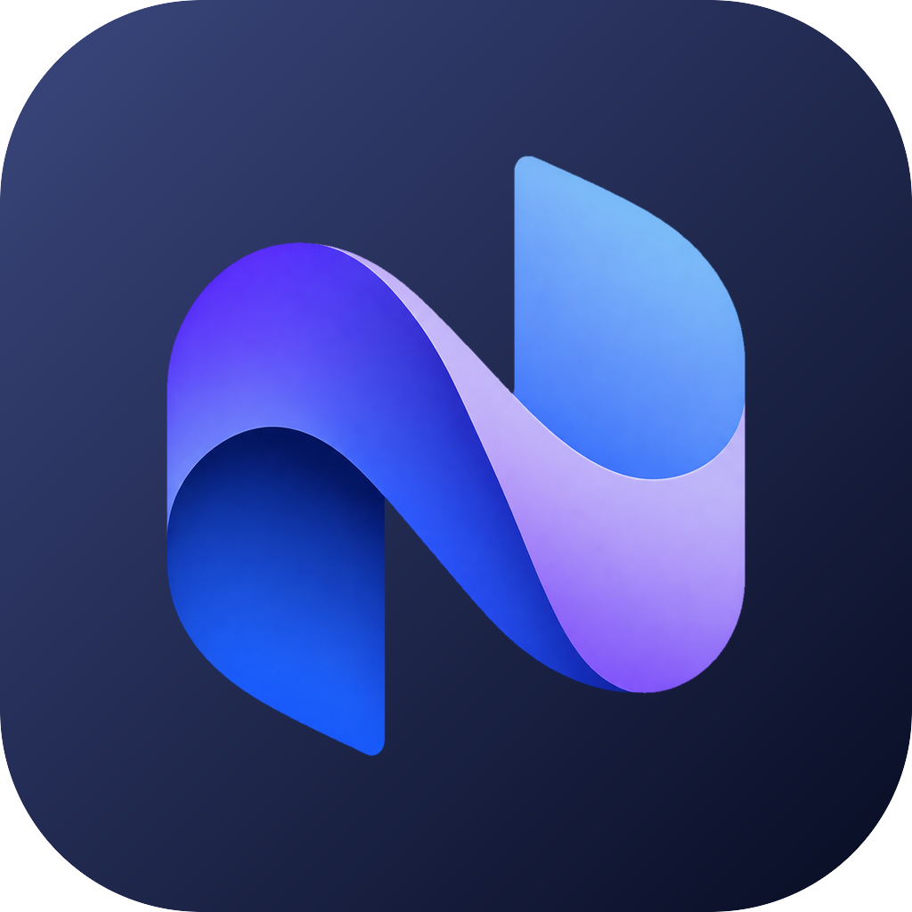
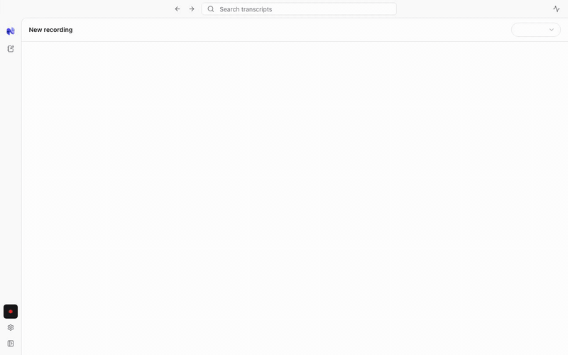
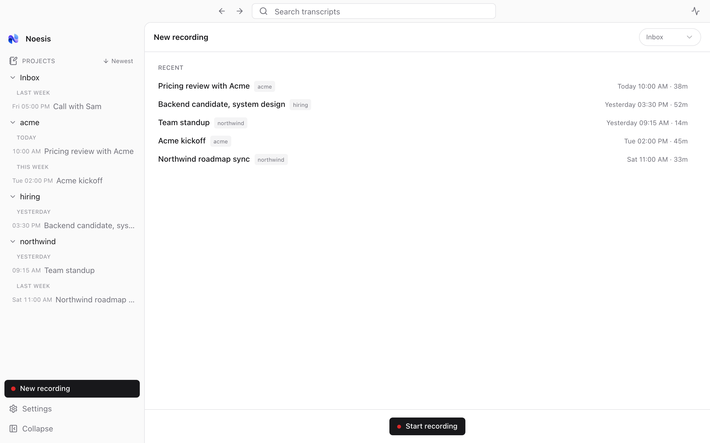
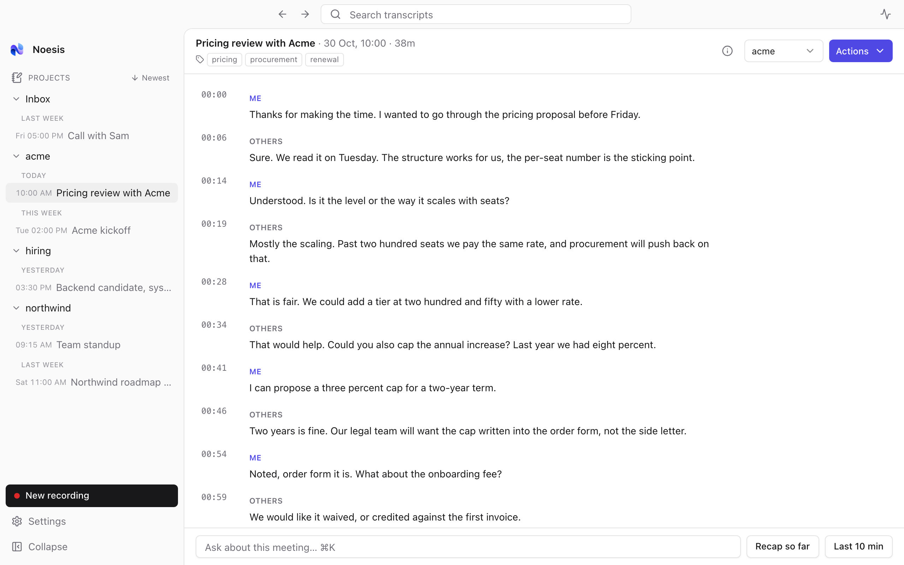
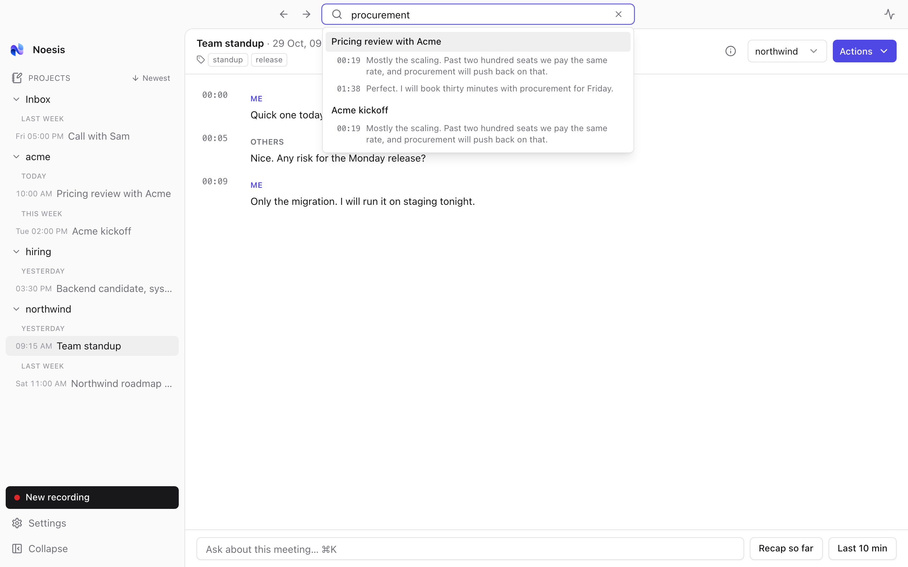
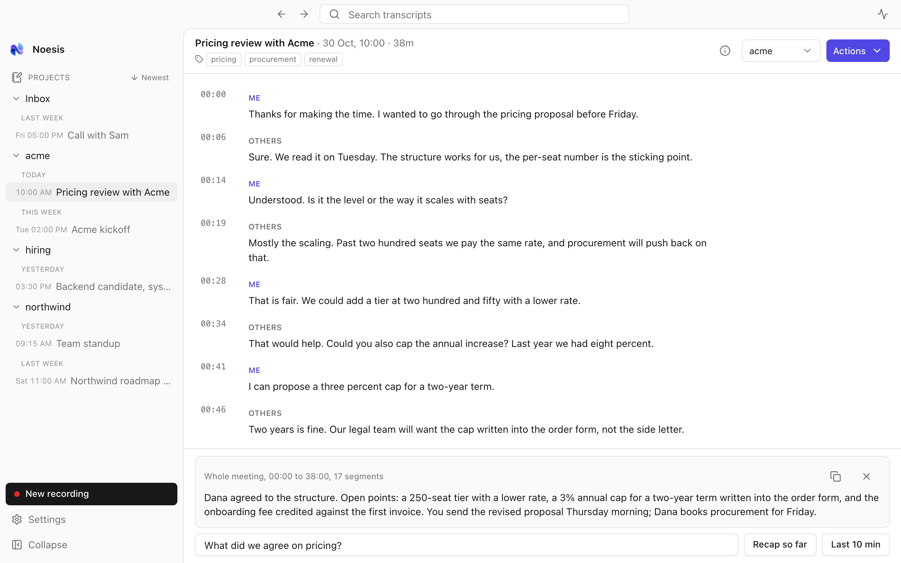

<div align="center">
  
  <h1>Noesis</h1>
  <p><b>A local meeting recorder that files accurate transcripts by project, for Claude to read.</b></p>
  <p>
    
    <a href="https://www.npmjs.com/package/@noesis-app/noesis-mcp"></a>
    
  </p>
</div>

Noesis records your calls, transcribes them on your Mac, and writes a plain `transcript.md` into a folder per project. An MCP server exposes that folder to Claude Code, so any wiki or repo can list, search and read your meetings without symlinks or copy-paste.

<p align="center"></p>

It is a dumb, accurate recorder. Audio and transcripts never leave the machine unless you pick a cloud model.

## What it does

- **Records mic and system audio** and labels each line `me` or `them` from which source was speaking.
- **Live transcript** with Parakeet while the call runs, then an automatic **enhance pass** with Whisper large-v3 after you stop. Jobs queue; the title-bar panel shows progress and cancels.
- **Stops by itself** when the call ends (any app holding the microphone on macOS 14+, Zoom on macOS 13). Auto-start is optional.
- **Projects are folders.** `<root>/<project>/<YYYY-MM-DD_HH-MM title>/`. Rename or move in Finder; the app reconciles.
- **Titles and tags** are generated after enhance with the configured model. Edit them by hand and they stay.
- **Per-project overrides** in `project.json`: language, enhance provider, enhance model.
- **Ask the meeting.** A box on the home and meeting pages answers questions over the live or saved transcript with a local model (Qwen built in, or Ollama, Claude, OpenAI, Groq, OpenRouter).

## Screens

| | |
|---|---|
|  |  |
|  |  |

Shots use invented demo data. Regenerate them with `npm --prefix scripts/readme-media run capture` ([how](scripts/readme-media/README.md)).

## Use it from Claude Code

```bash
claude mcp add --scope user noesis -- npx -y @noesis-app/noesis-mcp
```

Or click **Register** in Noesis, Settings, Recordings, Claude Code. Needs Node 22.18+. The server reads the filesystem only, so it works with the app closed.

| Tool | Does |
|---|---|
| `list_projects` | Projects with meeting count and last meeting date |
| `list_meetings` | Filter by project, tag, date range; newest first |
| `search_meetings` | Keyword search over titles, tags and transcript text |
| `get_transcript` | Markdown, plain text or JSON; optional time window; works mid-recording |
| `assign_meeting` | Move a meeting to a project or rename it |

## What lands on disk

Default root: `~/Movies/noesis-recordings` (Settings, Recordings to change it).

```
noesis-recordings/
  _inbox/
  acme/
    project.json                         optional overrides
    2026-10-26_14-30 kickoff-call/
      audio.mp4  transcript.md  transcripts.json  metadata.json  speakers.json
```

`transcript.md` is the contract:

```
---
title: "Kickoff call"
project: acme
started_at: 2026-10-26T14:30:05-04:00
quality: enhanced
model: whisper large-v3
speakers: me=Alex, them=Others
tags: [kickoff, pricing]
---
[00:00] Alex: Thanks for joining.
[00:04] Others: Happy to be here.
```

The folder is the source of truth; SQLite is an index rebuilt from it. Full schemas: [design spec, section 5](docs/superpowers/specs/2026-10-27-personal-meeting-recorder-design.md#5-contracts).

## Install

Download the DMG from the [latest release](https://github.com/astings/noesis/releases/latest). It is signed with a Developer ID and notarized by Apple, so it opens without a Gatekeeper warning. Apple silicon only (M1 and later). From v1.0.0 on, Noesis checks for updates itself and offers to install them (Settings, Updates).

## Build

To build from source on macOS (Apple silicon tested):

1. Install Xcode, Rust, Node 22 and pnpm 10
2. `cd frontend && pnpm install`
3. `./clean_build.sh` for an app bundle, or `./clean_run.sh` for a dev run

First launch asks for microphone and screen-recording permission (the latter for system audio). Coming from Meetily? Quit it first; Noesis offers to move its data and recordings over, and never deletes them.

More: [BUILDING.md](docs/BUILDING.md), [GPU acceleration](docs/GPU_ACCELERATION.md).

## Docs

- [Design specs](docs/superpowers/specs/) for every feature, with the decisions behind them
- [Implementation plans](docs/superpowers/plans/), one per phase
- [MCP server README](mcp/README.md)
- [CLAUDE.md](CLAUDE.md) for working on the code with Claude Code

## Credits and license

Started from [Meetily](https://github.com/Zackriya-Solutions/meetily) v0.4.1 by Zackriya Solutions. Built with [whisper.cpp](https://github.com/ggerganov/whisper.cpp), [Parakeet](https://huggingface.co/nvidia/parakeet-tdt-0.6b-v3) and [Tauri](https://tauri.app). MIT, see [LICENSE.md](LICENSE.md).
